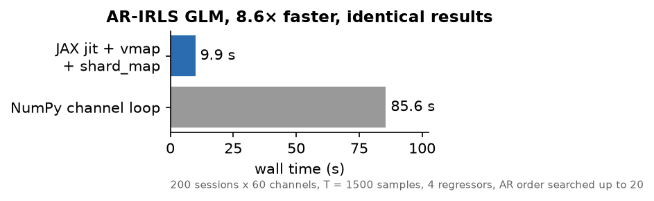
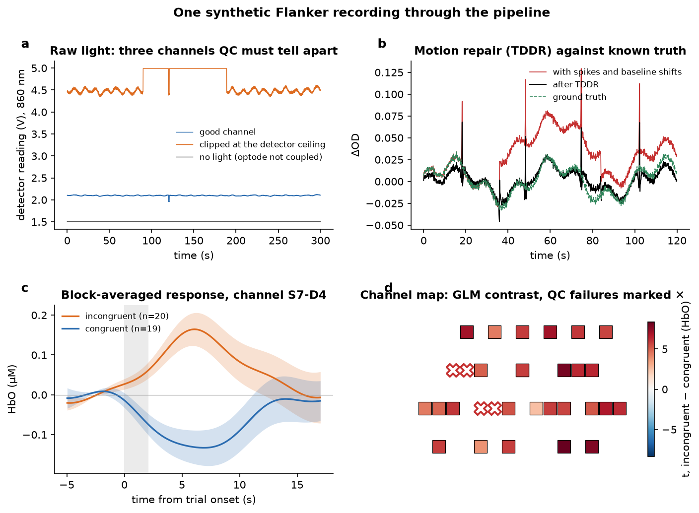
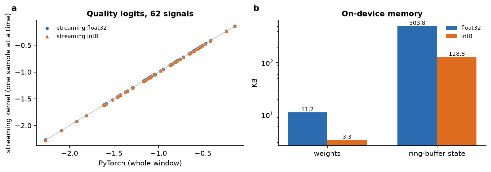

# wnirs — dense-sampling wearable fNIRS, from raw light to an int8 model

`wnirs` is a Python toolbox for **wearable functional near-infrared
spectroscopy (fNIRS)**: reading a headband's raw optical recordings,
channel-level quality control, signal processing, the statistics of
*precision* (single-person, many-session) neuroimaging, and a learning layer
that trains small time-series models and deploys them as streaming int8
kernels.

It implements the methods of

> Rahimpour Jounghani A. *et al.* **Wearable fNIRS platform for dense sampling
> and precision functional neuroimaging.** *npj Digital Medicine* 8, 271 (2025).

```
 tablet CSV + behaviour xlsx
        │ wnirs.io        read, pair with behaviour, trim runaway logs, dedupe sessions
        ▼
      Raw ── wnirs.qc     16 channel metrics → configurable pass/fail gates
        │ wnirs.preproc   dark level → OD → TDDR motion repair → MBLL → filtering → short-channel regression
        ▼
       Hb ── wnirs.analysis   AR-IRLS GLM (NumPy and JAX), connectivity, split-half reliability,
        │                     fingerprinting, ICC / G-theory, change points, rmcorr, EZ-diffusion
        └─── wnirs.ml         windows → DSP-feature baseline vs. self-supervised causal TCN
                              → streaming int8 kernel · ONNX (fp32 / int8)
```

## Highlights

- **Tested against known answers.** Around 270 tests. Each processing step is
  checked against a reference implementation on shared synthetic recordings,
  and checked behaviourally where the right answer is known: TDDR repairs a
  baseline shift, short-channel regression removes a shared systemic
  oscillation, MBLL inverts its own forward model, and the GLM recovers a
  planted effect.
- **JAX GLM.** The autoregressive, iteratively-reweighted GLM (AR-IRLS;
  Barker et al. 2013) is rewritten as fixed-shape JAX: Levinson–Durbin over
  the whole AR-order grid with masking, `lax.while_loop` convergence, and
  `vmap` over channels with `shard_map` over sessions. It matches the NumPy
  version to ~1e-13 and runs ~8× faster (60 channels × 200 sessions, laptop
  CPU; `scripts/bench_glm.py`).

  
- **Signal processing for a noisy wearable.** Dark-level correction from unused source–detector pairs, TDDR
  motion repair, spline / wavelet / Savitzky–Golay / PCA alternatives,
  baseline-shift repair, short-separation and global-signal regression, all
  as plain-array functions that can be reused outside the pipeline.
- **A learning layer built for the device** (`wnirs.ml`), described below.


*A synthetic Flanker recording, written in the headband's own file format, run through the pipeline.
(a) Raw light on a good, a clipped and an uncoupled channel, all of which QC separates.
(b) TDDR on a trace with known ground truth: baseline shifts are fully repaired, while fast spikes are only partly
removed, which is by design for the published variant that corrects below 0.5 Hz.
(c) Block-averaged HbO for the two conditions.
(d) GLM contrast per channel, with QC failures marked.*

<!-- RESULTS -->
## Learning on wearable fNIRS (`wnirs.ml`)

**Setup.** Each window is 30 s of HbO and HbR from 31 long channels: 62 signals × 150 samples at 5 Hz, z-scored per recording. The dataset is 2,917 windows from 200 dense-sampling recordings of 3 adults, over about 50 sessions and four tasks (Flanker, Go/No-Go, N-Back, rest).
- **Splits.** Every split holds out each person's **latest 25 % of sessions**, as whole sessions. No window of a test session is seen in training or self-supervised pretraining. Recording-level scores are a majority vote over the windows of each recording.
- **Seeds.** Means ± SD are over 3 seeds. The logistic-regression baseline is deterministic.

**Model.**
- **Encoder.** A causal, dilated, depthwise-separable temporal CNN with **3,143 parameters**. One shared encoder runs per signal, with a signal embedding and masked attention pooling.
- **Pretraining.** Masked causal reconstruction on unlabelled training windows.
- **Baseline.** Logistic regression on hand-crafted DSP features: relative band power in the task, Mayer-wave, respiratory and cardiac bands, plus spectral entropy, kurtosis, maximum first difference, lag-1 autocorrelation and Fisher-z connectivity.

| method | channel quality (AUC) | identity, per recording (acc.) | task state, per recording (acc.) |
|---|---|---|---|
| DSP features + logistic regression | 0.841 | 0.936 | 0.298 |
| encoder, from scratch | 0.894 ± 0.001 | 0.766 ± 0.043 | 0.305 ± 0.033 |
| encoder, pretrained + fine-tuned | 0.893 ± 0.004 | 0.780 ± 0.033 | 0.291 ± 0.033 |
| encoder, pretrained + linear probe | 0.681 ± 0.013 | 0.887 ± 0.068 | 0.305 ± 0.044 |


**What this shows.**
- **Channel quality: the learned encoder beats the DSP baseline (AUC 0.89 vs 0.84).** This is the task that matters on a device, flagging a channel that has lost contact before its data reach analysis. Pretraining does not improve it over training from scratch. A linear probe on the frozen pretrained encoder is weak (0.68), so the reconstruction objective does not by itself learn quality-relevant features.
- **Identity: pretraining helps, but the classical baseline still wins.** A frozen pretrained encoder with a linear head (0.89) beats full fine-tuning (0.78) and training from scratch (0.77). With three people, fine-tuning the whole encoder overfits, while the self-supervised features transfer. The baseline's connectivity features (0.94) remain the best identifier: they are the precision-imaging "fingerprint" that `wnirs.analysis.fingerprint` reports.
- **Task state is not decodable from 30 s windows by any method.** Every result is within 1.5 binomial SDs (±0.063) of the 25 % chance level (47 test recordings). After per-recording normalisation, the four tasks look alike over 30 s. Their differences are in event-locked responses, which the GLM captures and a window classifier does not. This is reported as a negative result rather than tuned away.

**Controlled preprocessing ablations** (seed 0; each variant changes exactly one preprocessing step):

| preprocessing | method | channel quality (AUC) | identity, per recording (acc.) | task state, per recording (acc.) |
|---|---|---|---|---|
| default | DSP features + logistic regression | 0.841 | 0.936 | 0.298 |
| default | encoder, pretrained + fine-tuned | 0.896 | 0.787 | 0.255 |
| no_ssr | DSP features + logistic regression | 0.842 | 0.957 | 0.298 |
| no_ssr | encoder, pretrained + fine-tuned | 0.890 | 0.830 | 0.298 |
| no_motion | DSP features + logistic regression | 0.817 | 0.936 | 0.255 |
| no_motion | encoder, pretrained + fine-tuned | 0.896 | 0.830 | 0.298 |

Neither ablation moves the learned model beyond seed-to-seed variation. Removing motion correction lowers the DSP baseline's channel-quality AUC (0.84 → 0.82), plausibly because its kurtosis and max-derivative features respond to the uncorrected artefacts as well as to coupling. The learned encoder is unaffected (0.90). Removing short-separation regression changes nothing beyond noise. With one seed per variant these are indications, not significance tests.

### On-device inference (`scripts/edge_report.py`)


*(a) The streaming kernel, fed one sample at a time, reproduces the PyTorch model, and the int8 version stays close.
(b) Memory on device: the weights are tiny, and the ring-buffer state dominates.*

| | |
|---|---|
| parameters | 3,143 |
| multiply-accumulates per input sample (62 signals) | 105 k (0.53 M MAC/s at 5 Hz) |
| weights, float32 / int8 | 11.2 KB / 3.3 KB |
| streaming state (ring buffers), float32 / int8 | 504 KB / 129 KB |
| ONNX latency per 30 s window, 1 CPU thread | 5.3 ms |

| channel-quality AUC on held-out sessions | |
|---|---|
| PyTorch | 0.896 |
| ONNX fp32 | 0.896 |
| ONNX Runtime static int8 (QDQ) | 0.833 |
| streaming float kernel (subset of 150 windows; PyTorch on the same subset 0.907) | 0.907 |
| streaming int8 kernel, same subset | 0.893 |

- **Streaming kernel.** It folds BatchNorm into the convolutions and keeps one ring buffer per dilated layer. It reproduces PyTorch to 1.4e-6, consuming one sample at a time.
- **int8.** With per-channel weight scales and per-layer activation scales calibrated on real windows, it loses 0.014 AUC. ONNX Runtime's generic static quantisation loses 0.06 and gives no speed-up at this model size.
- **Memory.** The binding constraint is **state, not weights**. The dilated layers must remember 129 past steps × 16 features × 62 signals. That fits a Cortex-M7/M55-class part, but not a small MCU. The levers are a narrower encoder, a shorter dilation stack, or a lower internal rate for the deeper layers. All three are one-line changes to `SignalEncoder`.

<!-- /RESULTS -->

## Install

```bash
python -m venv .venv && source .venv/bin/activate
pip install -e ".[ml,dev]"          # core + PyTorch / JAX / ONNX + pytest
pytest                              # 267 tests, under a minute
```

Reference outputs for the tests are checked in under `tests/fixtures/`.

## Quick start

```python
from wnirs.io import find_sessions, read_brain_games
from wnirs.qc import channel_qc
from wnirs.preproc import preprocess
from wnirs.analysis import glm, connectivity

sessions = find_sessions("data/")                 # one row per recording, duplicates resolved
raw = read_brain_games(sessions.File[0])          # Raw: intensity, events, layout
hb = preprocess(raw)                              # Hb: HbO / HbR in µM, channel status
qc = channel_qc(raw, hb)                          # per-channel metrics and pass/fail
fit = glm(hb)                                     # AR-IRLS betas, t, p per channel × condition
```

Learning pipeline:

```bash
python scripts/build_windows.py data/ --out runs/windows_default.npz
python scripts/run_experiments.py runs/windows_default.npz --out runs/results
python scripts/edge_report.py runs/windows_default.npz \
    --encoder runs/results/pretrained_default/pretrained_s0_e15.pt
```

## Layout

| package | contents |
|---|---|
| `wnirs.io` | Brain Games tablet reader, session discovery and de-duplication, layouts, tracksheet join, manifest, behaviour summaries |
| `wnirs.qc` | 16 channel metrics (SCI, PSP, SNR, CV, light-over-noise, saturation, motion rate, HbCorr, CNR …), gate system |
| `wnirs.preproc` | optical density, dark level, MBLL with age-dependent DPF, TDDR / spline / wavelet / sgolay / PCA motion correction, baseline shift, filtering, SSR, global regression |
| `wnirs.analysis` | HRF, design matrices, AR-IRLS (NumPy + JAX), contrasts, block averages, connectivity, rmcorr, reliability and fingerprinting, ICC, G-theory, mixed models, change points, state–trait, growth curves, EZ-diffusion, BH-FDR |
| `wnirs.ml` | windowing and leakage-free splits, DSP features, causal TCN encoder, self-supervised pretraining, training loops, streaming int8 kernel, ONNX export / quantisation |
| `scripts/` | window building, experiments, results tables, edge report, GLM benchmark, figures |

File readers currently cover the Brain Games headband (tablet CSV + behaviour workbook) and plain CSV.

## Data

No participant data are included; every figure in this repository is built from
synthetic recordings (`python scripts/make_figures.py`). The synthetic recording generator
(`tests/synthetic.py`) writes files in the device's exact format, with known
haemodynamic responses, motion, saturated and dark channels.

## Citation

If you use this toolbox, please cite the *npj Digital Medicine* paper above.

## License

MIT, see `LICENSE`.
